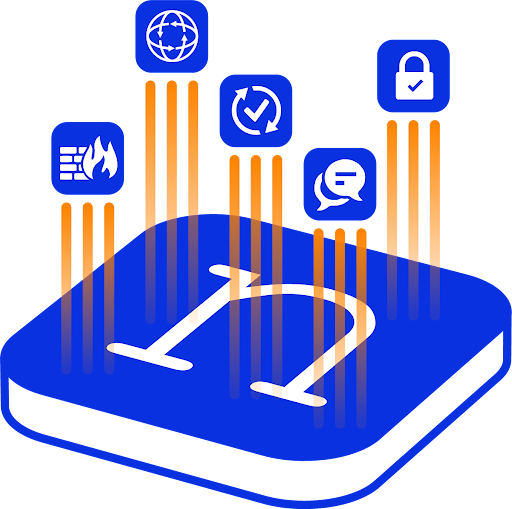
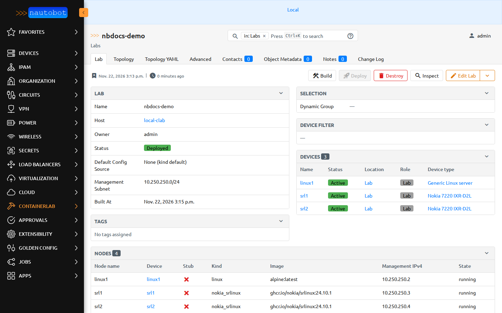

# Containerlab Orchestrator

  
   
  
  
  
  
   
  An <a href="https://networktocode.com/nautobot-apps/">App</a> for <a href="https://nautobot.com/">Nautobot</a>.

## Overview

Containerlab Orchestrator makes containerlab labs from the devices and cables in Nautobot. You select the devices of
a lab, and the app builds a containerlab topology from them. The topology has one node for each device, and links
from the cables of the devices.

Node mappings give the containerlab kind, the image, and the interface names of each device model or platform. The
lab jobs deploy the topology to a containerlab host, read the state of each node, and destroy the lab. The lab page
shows the nodes, a topology graph, and the topology YAML.

The app talks to each host only through the clab-api-server REST API. It needs no SSH access.

### Screenshots

More screenshots are on the [Using the App](https://nautobot-containerlab-orchestrator.readthedocs.io/en/latest/user/app_use_cases/#screenshots) page of the documentation.

## Documentation

Full documentation for this App is on [Read the Docs](https://nautobot-containerlab-orchestrator.readthedocs.io/en/latest/):

- [User Guide](https://nautobot-containerlab-orchestrator.readthedocs.io/en/latest/user/app_overview/) - Overview, Using the App, Getting Started.
- [Administrator Guide](https://nautobot-containerlab-orchestrator.readthedocs.io/en/latest/admin/install/) - How to Install, Configure, Upgrade, or Uninstall the App.
- [Developer Guide](https://nautobot-containerlab-orchestrator.readthedocs.io/en/latest/dev/contributing/) - Extending the App, Code Reference, Contribution Guide.
- [Release Notes / Changelog](https://nautobot-containerlab-orchestrator.readthedocs.io/en/latest/admin/release_notes/).
- [Frequently Asked Questions](https://nautobot-containerlab-orchestrator.readthedocs.io/en/latest/user/faq/).

### Contributing to the Documentation

You can find all the Markdown source for the App documentation under the [`docs`](https://github.com/jtdub/nautobot-app-containerlab-orchestrator/tree/develop/docs) folder in this repository. For simple edits, a Markdown capable editor is sufficient: clone the repository and edit away.

If you need to view the fully-generated documentation site, you can build it with [MkDocs](https://www.mkdocs.org/). A container hosting the documentation can be started using the `invoke` commands (details in the [Development Environment Guide](https://nautobot-containerlab-orchestrator.readthedocs.io/en/latest/dev/dev_environment/#docker-development-environment)) on [http://localhost:8001](http://localhost:8001). Using this container, as your changes to the documentation are saved, they will be automatically rebuilt and any pages currently being viewed will be reloaded in your browser.

Any PRs with fixes or improvements are very welcome!

## Questions

For any questions or comments, please check the [FAQ](https://nautobot-containerlab-orchestrator.readthedocs.io/en/latest/user/faq/) first. Feel free to also swing by the [Network to Code Slack](https://networktocode.slack.com/) (channel `#nautobot`), sign up [here](http://slack.networktocode.com/) if you don't have an account.
